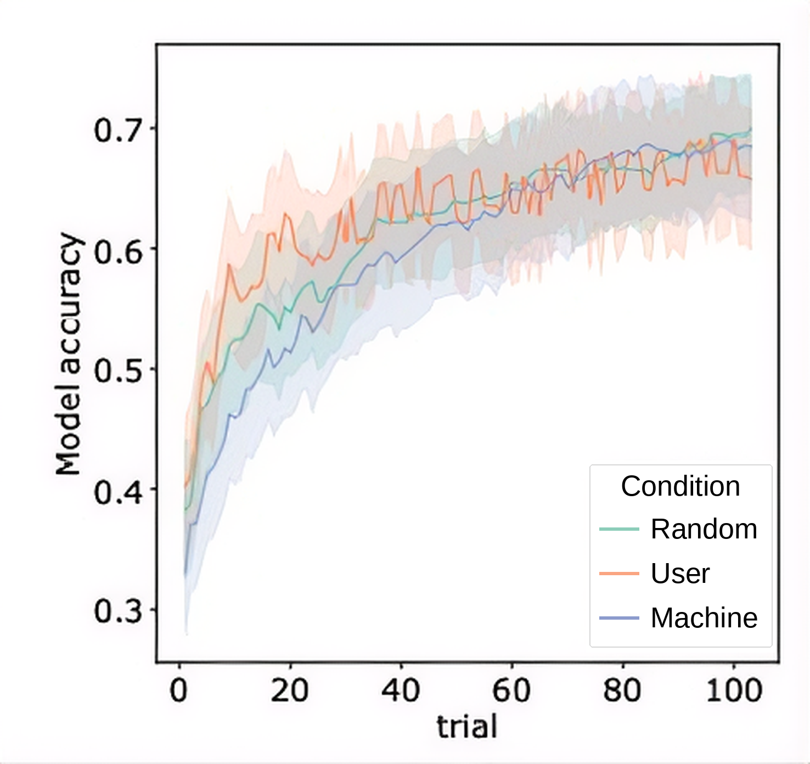
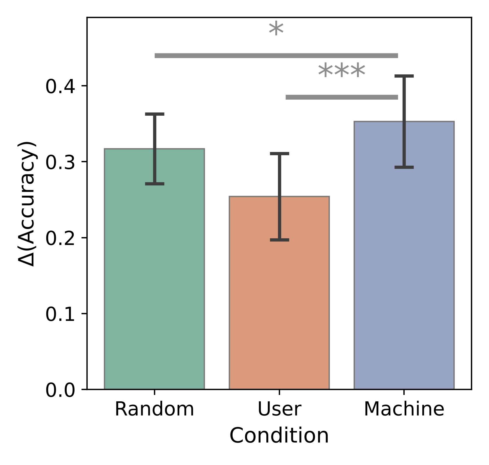
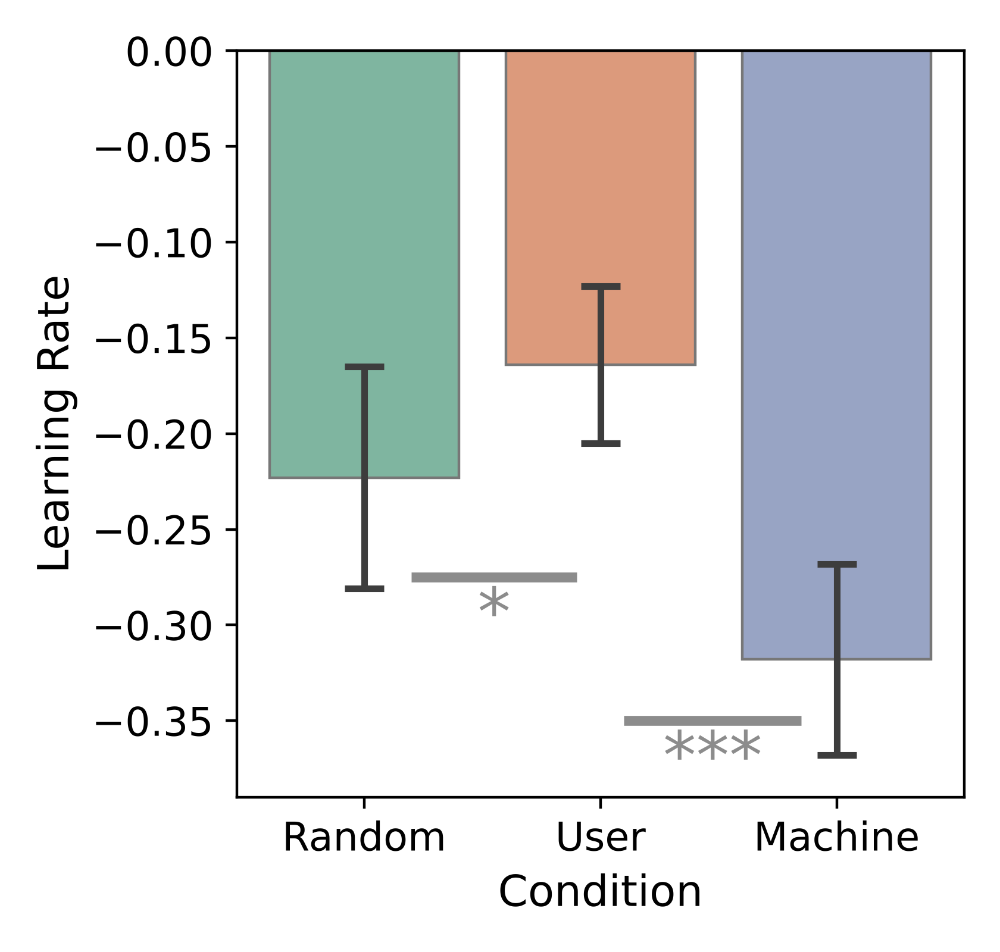

*My second PhD study: how should a machine-learning prosthetic arm be trained, and does the way it is trained change how well it works and how well its user understands it?*

[View Code](https://github.com/vayneeS/prosthesis-strategies-with-ml)
 
---
 
## The Problem
 
Some modern prosthetic arms read the electrical activity of the forearm muscles (EMG) and use machine learning to turn it into movements such as closing the hand or rotating the wrist. The user teaches the arm by performing each gesture while the system records the muscle signal.
 
These arms are still rarely used in rehabilitation or sold commercially. One reason is that it is unclear how users should go about training them, so recognition accuracy stays low in everyday life. Muscle signals also drift with tiredness or arm posture, so the arm has to be retrained regularly. A user who understands when the arm is likely to get a gesture right or wrong can work around its mistakes.
 
Most training programmes ask for gestures in a random order. Little is known about whether the order, and who chooses it, makes a difference.
 
**Question:** how does the way gestures are chosen during training (at random, by the user, or by the machine) affect the accuracy of the model and the user's understanding of how it behaves?
 
---
 
## Approach
 
I ran a lab experiment with 51 able-bodied volunteers. They taught a machine-learning model to recognise 8 hand gestures (such as open hand, close hand, palm up, palm down and pointing) while wearing an EMG armband. After every example, the model was retrained and a prosthetic hand showed the gesture it recognised, so participants got immediate feedback.
 
Each participant was assigned to one of three groups (with roughly equal numbers in each), which differed only in how the next gesture to practise was chosen:
 
- **Random** – the system asks for the gestures in a shuffled order (the baseline).
- **User** – the participant chooses which gesture to practise next (called *teacher-led* in the paper).
- **Machine** – the system asks for the gesture the model currently separates least well from the others, so practice goes where it is needed most (called *learner-led* in the paper).
<figure style="width: 50%; margin: 0 auto;">
 
  <figcaption>Participants wore a Myo armband and performed gestures following one of three training strategies</figcaption>
</figure>
After training, each participant did three more things:
 
1. **A test.** They performed new examples of every gesture, used to measure the model's accuracy.
2. **A "positives and negatives" task.** They were asked to perform gestures they expected the arm to recognise correctly, and gestures they expected it to get wrong, while explaining their reasoning out loud. This measures how well they understood the model.
3. **A questionnaire.** They rated how accurately they thought the arm recognised each gesture.

---
 
## Data Pipeline
 
I built the pipeline that turns the armband's raw muscle signals into something the model can learn from:
 
1. **Summarising the signal.** The armband has 8 sensors. For each short time window (about 128 ms), I computed the signal's strength (its root mean square) on each sensor. This is a standard summary for this type of classifier, and it makes results comparable with other prosthesis studies.
2. **One example per gesture.** Each example was about 2 seconds long. I averaged it into a single list of 8 values, one per sensor.
3. **Tracking progress.** The model was retrained after each example (16 starting examples, then 104 training examples, so 120 in total). After each retraining I measured its accuracy on the test data, which gave a learning curve for every participant.

---
 
## The Machine Learning Model
 
I used a Linear Discriminant Analysis (LDA) classifier from Scikit-learn. It is the most commonly used model for recognising muscle signals in realistic conditions, and it can be retrained very quickly, which made it possible to update the model after every single example.
 
**How the Machine group chose gestures:** after each example, I computed for each gesture how well its examples are grouped together compared with how far they sit from the other gestures. The gesture with the lowest score is the one the model is most likely to confuse, so it was requested next. I also made the score account for how many examples each gesture already had, because in a pilot study this strategy otherwise kept asking for the same gestures and left the others with almost no data.
 
---
 
## Statistical Analysis
 
The accuracy of the final model was similar in all groups, so I looked at how accuracy changed during training. All tests below are standard comparisons between the three groups.
 
**Gain in accuracy:** the difference between the accuracy of the first model (after the 16 starting examples) and the last one. The groups differed clearly (p < 0.001). The Machine group gained significantly more than the Random group (p < 0.05) and the User group (p < 0.001). The difference between Random and User was borderline (p = 0.053).
 
**Learning rate:** I measured how quickly each participant's model errors fell as examples were added. This is the slope of a line fitted to the logarithm of the error against the logarithm of the number of examples. The slope is negative because errors go down, so a larger absolute value means errors fall faster. The groups differed significantly (p < 0.001). The Machine group's slope was steeper than the User group's (p < 0.001) and the Random group's (p = 0.023).
 
**Understanding of the model:** participants in the User group were the worst at producing gestures the model would recognise correctly, compared with the Machine group (p = 0.039), and the difference with the Random group was borderline (p = 0.061). For gestures the model would get wrong, there was no difference between groups. In the questionnaire, only the Machine group's ratings matched the model's true accuracy per gesture (correlation r = 0.30, p < 0.001); in the other two groups the ratings were not significantly related to the real accuracy.
 
---
 
## Key Results
 
### 1. All three strategies ended at about the same accuracy

The final models reached 71% (Random), 66% (User) and 68% (Machine) accuracy on the test, with no significant difference. The strategies differ in how the model got there.

<figure style="width: 50%; margin: 0 auto;">
 
  <figcaption>Participants wore a Myo armband and performed gestures following one of three training strategies</figcaption>
</figure>
 
### 2. Machine-selected gestures gave the biggest improvement

Starting from similar accuracy (around 30%), the Machine group gained the most over training. Their error fell faster than in the other two groups, according to the learning-rate measure. The User group started higher (about 38%, not a statistically significant difference) and gained the least.

<figure style="flex: 1; margin: 0;">
  
  <figcaption>Gain in accuracy between the first and last model</figcaption>
</figure>
<figure style="flex: 1; margin: 0;">
  
  <figcaption>Learning rate (more negative means errors fell faster)</figcaption>
</figure>

 
### 3. Machine-selected gestures made participants more consistent
Participants in all groups became more consistent at performing each gesture over time. This increased the most in the Machine group, where practice was concentrated on the gestures that were hardest to tell apart.
 
### 4. Machine-selected gestures led to a better understanding of the model
Participants in the Machine group were better at anticipating which of their gestures would be recognised, and were the only group whose rating of the model's accuracy followed its true accuracy.
 
---
 
## Takeaways
 
**Letting the system choose can pay off.** Asking for the gestures the model finds hardest led to a larger accuracy gain, faster error reduction and a clearer picture of the model in the user's mind than random or self-chosen practice, even though final accuracy was the same.
 
**Self-chosen practice was not better.** Letting users choose gave the smallest gain, and the weakest understanding of what the model would recognise. This fits earlier work showing that people are rarely the best teachers of a machine when left alone.
 
**Recommendation.** The strategies each have strengths. The paper suggests sharing the initiative: for example, letting users direct the early part of training and then handing over to machine-selected gestures. Whether users find these strategies engaging, or would stick with them, was not measured and needs further study.
 
**Limits.** Participants were able-bodied volunteers in a single lab session, so the results need to be tested with prosthesis users, over several days and in everyday conditions. The "positives and negatives" task is not a standard way of measuring understanding, and thinking aloud may have made it harder.

## Reference

[Comparing Teaching Strategies of a Machine Learning-based Prosthetic Arm — HAL Archive](https://amu.hal.science/ISIR_ACIDE/hal-04527854v1)

*Published at IUI 2024. Co-authored with Baptiste Caramiaux, [Nathanaël Jarrassé](https://www.n-jarrasse.fr/), [Téo Sanchez](https://teo-sanchez.github.io/).*

