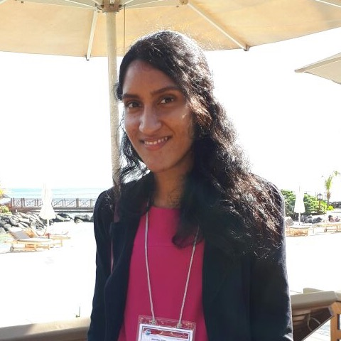

  

    
  

  

    <!-- <h1 class="home-hero__name">{{ site.title }}</h1>
    
{{ site.description }}
 -->
    

    

      Hello, I'm Vaynee Sungeelee. I build and test data and machine-learning systems, with a PhD in Human-Computer Interaction and three years of Salesforce consulting behind me. My work looks at how people understand and adapt to intelligent systems, especially in assistive technology. I write the code and run the analysis, and I use experimental and qualitative methods to check that what I build works for the people using it. I enjoy turning those findings into practical recommendations that teams can act on.
    

    

  

